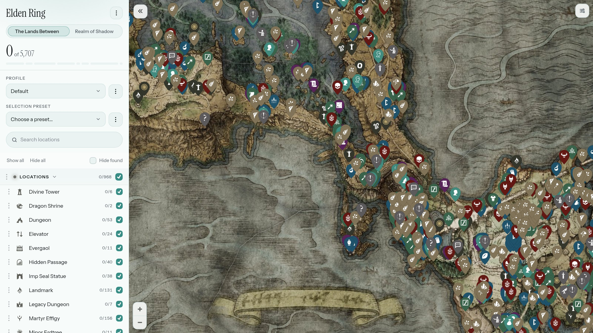
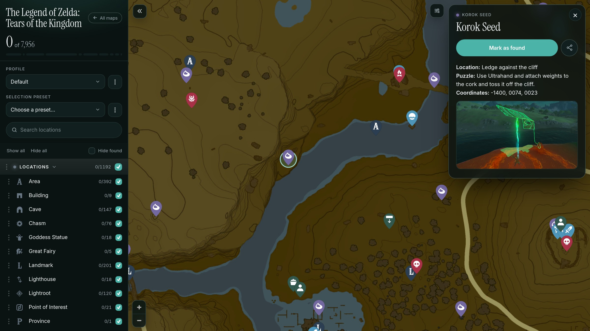

# Verticordia Atlas

[](https://bun.sh/)
[](https://maplibre.org/)
[](https://sharp.pixelplumbing.com/)
[](https://marked.js.org/)
[](LICENSE)

Interactive game maps that work offline, keep your progress on your own device,
and do not hold the basics hostage behind a paywall.

[](https://atlas.verticordia.com:11680/maps/elden-ring/)

---

## Why Atlas?

Finishing a game properly means keeping track of hundreds of collectibles, and
interactive maps that help with that tend to cap how much you can mark unless
you subscribe, and to need a connection at exactly the moments you do not have
one.

Verticordia Atlas is built as an answer to that: the whole map, progress
without a limit, and nothing locked away that a printed page and a pencil would
have given you for free.

## What It Does

Atlas shows interactive game maps and remembers everything you have found. It
is local-first: all progress, custom markers, notes, freehand drawings,
category filters, and camera positions are saved directly to your browser's
IndexedDB. Entire map pyramids can be kept offline as single streaming packs
served by the Service Worker without an active internet connection.

You can maintain separate profiles for different playthroughs without
artificial limits, and export or import your progress as plain JSON whenever
you wish. Custom markers with markdown notes, freehand pen and highlighter
strokes, and polygon selection tools let you plan routes and update
collectibles in bulk.

An account is strictly optional. Progress can be synchronized between devices
in the background using Google sign-in or an anonymous 128-bit Base32 secret
key with checksum over WebSockets. The browser client has zero npm runtime
dependencies: third-party client libraries (`maplibre-gl`, `marked`,
`perfect-freehand`, and `lucide/icons.json`) are vendored in `public/vendor/`,
and fonts are self-hosted. The server side does indeed have runtime npm
dependencies: `unique-names-generator` (for generating memorable account
pseudonyms) and `sharp` (server and scripts only, loaded lazily for tile
stitching and downsampling so the server can boot without it). Atlas runs
without advertising or analytics, and relies entirely on vanilla TypeScript
bundled and executed by Bun.

[](https://atlas.verticordia.com:11680/maps/totk/?loc=281856&map=hyrule)

## Getting Started

Building and running Atlas requires [Bun](https://bun.sh/), managed via
[`mise`](https://mise.jdx.dev/) or installed standalone.

```bash
# Build client bundles into public/
bun run build

# Start the local server (HTTP static server, tile engine, and sync API)
bun run start

# Run the test suite
bun test

# Format code
bun fmt
```

## License

Verticordia Atlas is free software licensed under the [GNU Affero General
Public License v3 (AGPL-3.0-only)](LICENSE).